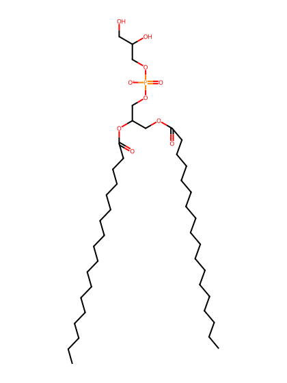
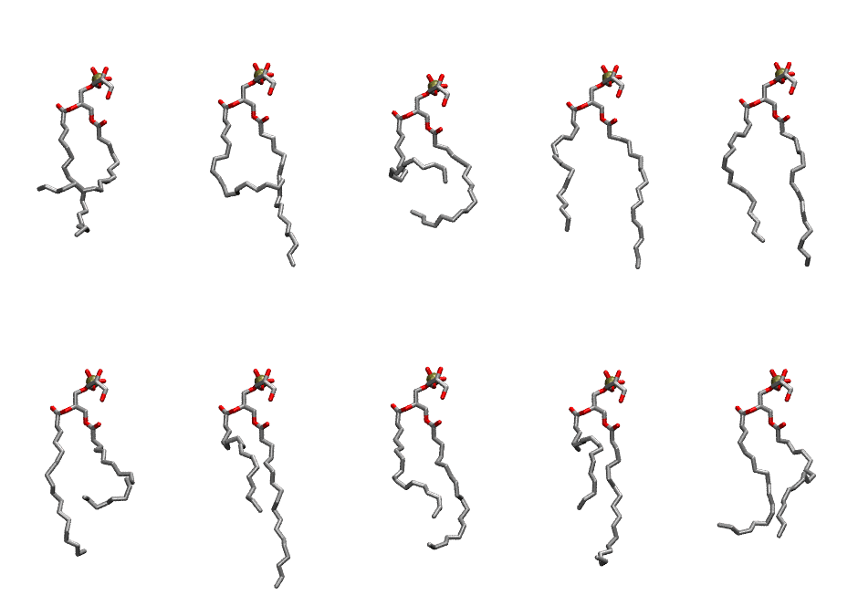

.. _lipid_gallery sopg:

SOPG
====

**1-Stearoyl-2-Oleoyl-Phosphatidylglycerol**

==============  ========================================
CHARMM resname  ``SOPG``
Net charge      -1.00
Atoms           133
Topology file   ``toppar_all36_lipid_miscellaneous.str``
Conformers      10 fluid
==============  ========================================

Structure
---------

Conformers
----------

The grid packer draws a conformer per lipid from this ensemble, so what the ensemble contains is what a built bilayer is made of. A leaflet declared ``phase: Lo`` generates an ordered ensemble when a build first needs it. All conformers are rendered at one shared scale.

===========  =============  ================  ================
Conformer    Head-tail (Å)  Max internal (Å)  Min chain extent
===========  =============  ================  ================
``SOPG-00``  8.19           22.53             0.36
``SOPG-01``  7.65           26.56             0.41
``SOPG-02``  6.38           19.85             0.35
``SOPG-03``  13.36          26.85             0.68
``SOPG-04``  15.09          25.89             0.76
``SOPG-05``  8.94           23.59             0.39
``SOPG-06``  10.58          27.67             0.55
``SOPG-07``  11.52          23.66             0.59
``SOPG-08``  10.08          24.86             0.53
``SOPG-09``  12.31          23.48             0.61
===========  =============  ================  ================

*Min chain extent* is how far the least-extended acyl chain descends below its own attachment carbon, as a fraction of that chain's all-trans contour; an all-trans chain scores 1.0, and a conformer under 0.25 is rejected at generation as folded.

Provenance
----------

How the ensemble was generated, read from the entry's own ``info.yaml``:

===================  ============
Setting              ``SOPG``
===================  ============
Sampler              ``mc``
Phase                none (fluid)
Trans bias           0.0
Chain order          0.090
MC seed              0
Chains               2
Cylinder APL         60.0 Ų
Cylinder inflation   1.9
Equilibration steps  20000
Decorrelation steps  3000
Max MC angle         30°
Radius scale         0.8
Axial bias           1.0
===================  ============
