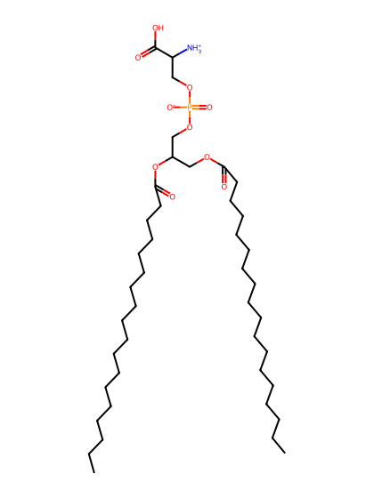
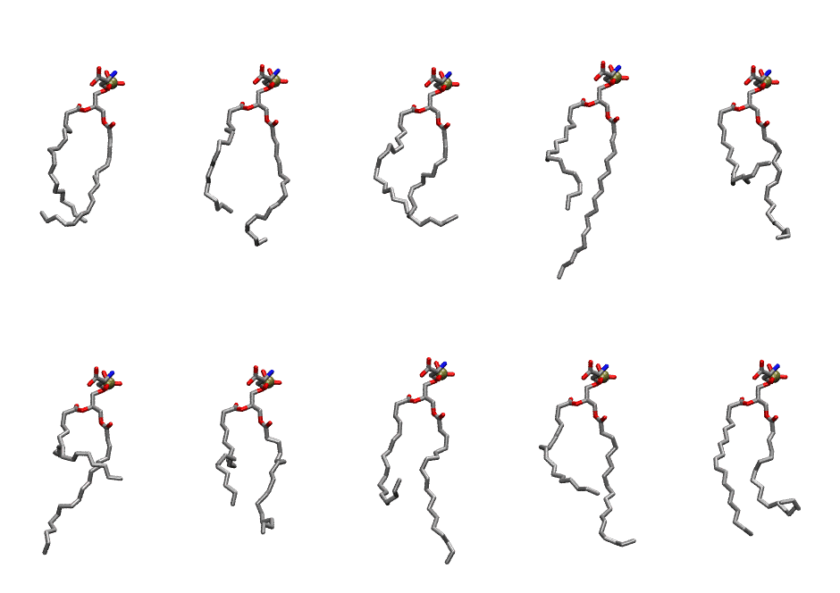
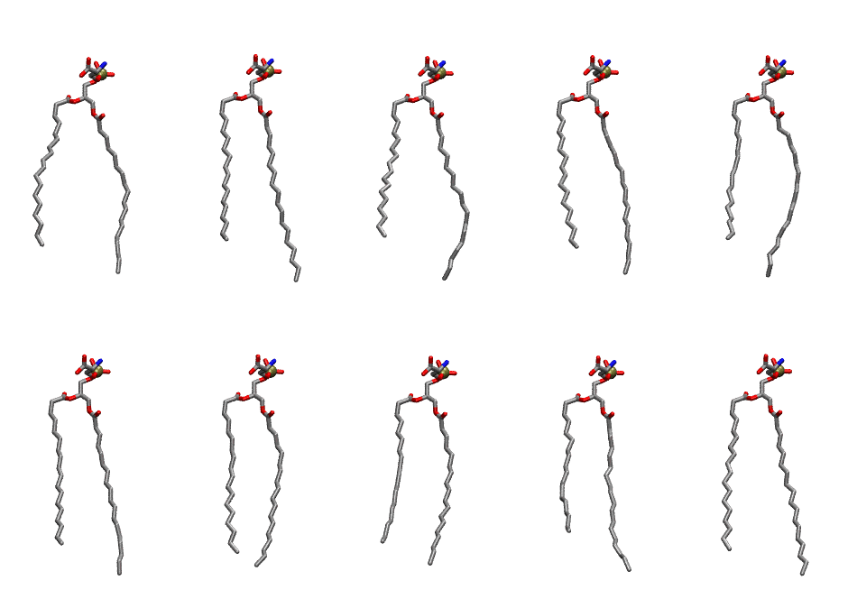

.. _lipid_gallery sops:

SOPS
====

**1-Stearoyl-2-Oleoyl-Phosphatidylserine**

==============  ==========================================
CHARMM resname  ``SOPS``
Net charge      -1.00
Atoms           133
Topology file   ``toppar_all36_lipid_miscellaneous.str``
Conformers      10 fluid, 10 liquid-ordered (``SOPS__Lo``)
==============  ==========================================

Structure
---------

Conformers
----------

The grid packer draws a conformer per lipid from an ensemble, so what the ensemble contains is what a built bilayer is made of. SOPS ships two: a fluid one, used by default, and a liquid-ordered one, used for a leaflet declared ``phase: Lo``. All conformers on this page are rendered at one shared scale.

Fluid (``SOPS``)
~~~~~~~~~~~~~~~~

===========  =============  ================  ================
Conformer    Head-tail (Å)  Max internal (Å)  Min chain extent
===========  =============  ================  ================
``SOPS-00``  11.31          23.12             0.50
``SOPS-01``  11.33          24.11             0.61
``SOPS-02``  11.08          21.17             0.52
``SOPS-03``  11.41          29.12             0.62
``SOPS-04``  5.11           24.33             0.32
``SOPS-05``  6.91           26.06             0.41
``SOPS-06``  10.28          24.17             0.56
``SOPS-07``  8.30           27.02             0.47
``SOPS-08``  9.63           25.01             0.53
``SOPS-09``  10.80          23.18             0.48
===========  =============  ================  ================

Liquid-ordered (``SOPS__Lo``)
~~~~~~~~~~~~~~~~~~~~~~~~~~~~~

===========  =============  ================  ================
Conformer    Head-tail (Å)  Max internal (Å)  Min chain extent
===========  =============  ================  ================
``SOPS-00``  16.22          28.54             0.84
``SOPS-01``  15.90          29.58             0.82
``SOPS-02``  15.23          28.86             0.79
``SOPS-03``  16.74          29.01             0.86
``SOPS-04``  15.63          28.75             0.81
``SOPS-05``  16.41          29.20             0.85
``SOPS-06``  17.47          28.48             0.86
``SOPS-07``  15.97          28.47             0.83
``SOPS-08``  14.68          28.64             0.77
``SOPS-09``  17.15          29.25             0.88
===========  =============  ================  ================

*Min chain extent* is how far the least-extended acyl chain descends below its own attachment carbon, as a fraction of that chain's all-trans contour; an all-trans chain scores 1.0, and a conformer under 0.25 is rejected at generation as folded.

Provenance
----------

How each ensemble was generated, read from the entry's own ``info.yaml``:

===================  ============  ============
Setting              ``SOPS``      ``SOPS__Lo``
===================  ============  ============
Sampler              ``mc``        ``mc``
Phase                none (fluid)  Lo
Trans bias           0.0           40.0
Chain order          0.112         0.311
MC seed              0             0
Chains               2             2
Cylinder APL         60.0 Ų       60.0 Ų
Cylinder inflation   1.9           1.9
Equilibration steps  20000         20000
Decorrelation steps  3000          3000
Max MC angle         30°           30°
Radius scale         0.8           0.8
Axial bias           1.0           1.0
===================  ============  ============
