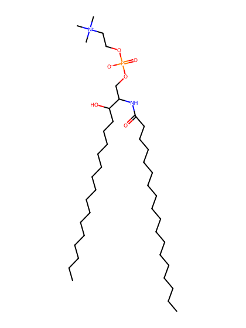
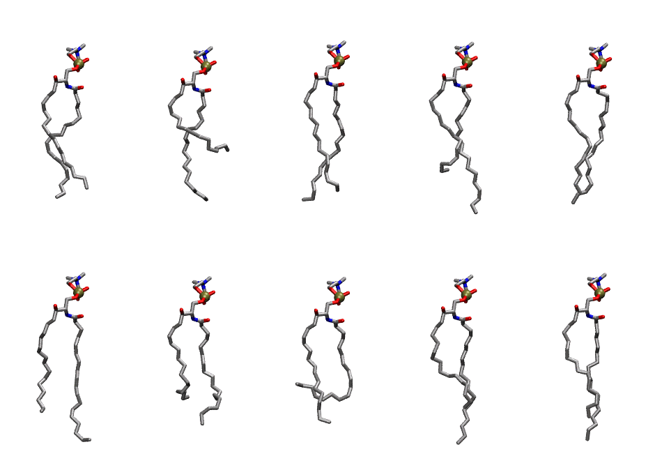
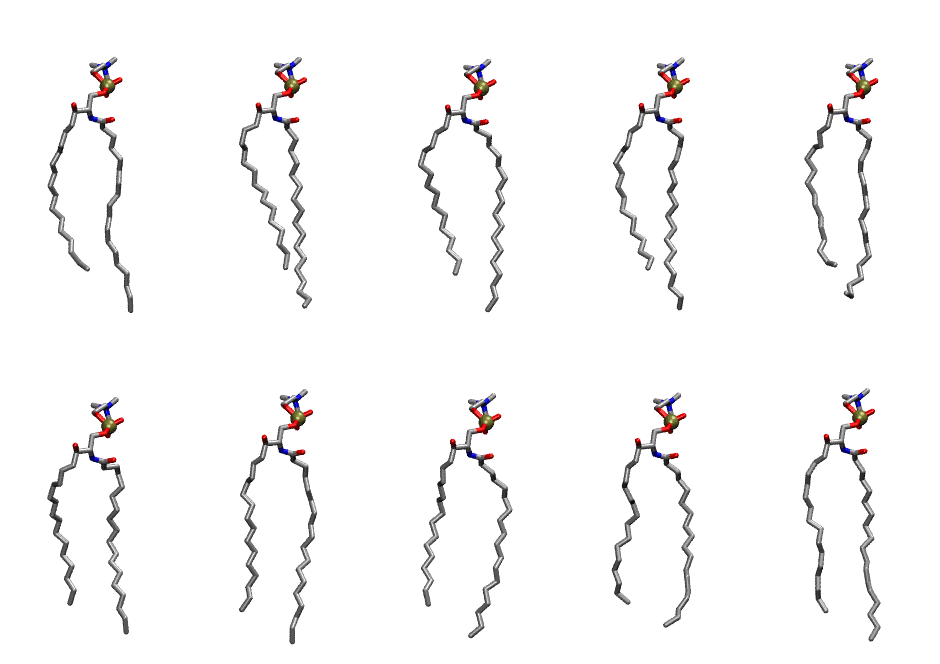

.. _lipid_gallery ssm:

SSM
===

**sphingomyelin d18:1/18:0**

==============  =========================================
CHARMM resname  ``SSM``
Net charge      0.00
Atoms           133
Topology file   ``toppar_all36_lipid_sphingo.str``
Conformers      10 fluid, 10 liquid-ordered (``SSM__Lo``)
==============  =========================================

Structure
---------

Conformers
----------

The grid packer draws a conformer per lipid from an ensemble, so what the ensemble contains is what a built bilayer is made of. SSM ships two: a fluid one, used by default, and a liquid-ordered one, used for a leaflet declared ``phase: Lo``. All conformers on this page are rendered at one shared scale.

Fluid (``SSM``)
~~~~~~~~~~~~~~~

==========  =============  ================
Conformer   Head-tail (Å)  Max internal (Å)
==========  =============  ================
``SSM-00``  15.19          25.30
``SSM-01``  9.08           24.63
``SSM-02``  16.00          26.45
``SSM-03``  12.72          27.32
``SSM-04``  15.96          26.11
``SSM-05``  14.38          27.73
``SSM-06``  11.63          24.47
``SSM-07``  9.58           25.25
``SSM-08``  13.42          27.27
``SSM-09``  15.07          26.71
==========  =============  ================

Liquid-ordered (``SSM__Lo``)
~~~~~~~~~~~~~~~~~~~~~~~~~~~~

==========  =============  ================
Conformer   Head-tail (Å)  Max internal (Å)
==========  =============  ================
``SSM-00``  15.75          28.44
``SSM-01``  15.58          28.30
``SSM-02``  15.95          28.23
``SSM-03``  15.59          27.89
``SSM-04``  15.19          27.11
``SSM-05``  15.09          26.39
``SSM-06``  16.61          28.40
``SSM-07``  15.61          27.46
``SSM-08``  15.46          27.17
``SSM-09``  16.84          28.48
==========  =============  ================

Provenance
----------

How each ensemble was generated, read from the entry's own ``info.yaml``:

===================  ============  ===========
Setting              ``SSM``       ``SSM__Lo``
===================  ============  ===========
Sampler              ``mc``        ``mc``
Phase                none (fluid)  Lo
Trans bias           0.0           6.25
Chain order          0.210         0.305
MC seed              0             0
Chains               2             2
Cylinder APL         60.0 Ų       60.0 Ų
Cylinder inflation   1.9           1.9
Equilibration steps  20000         20000
Decorrelation steps  3000          3000
Max MC angle         30°           30°
Radius scale         0.8           0.8
Axial bias           1.0           1.0
===================  ============  ===========
