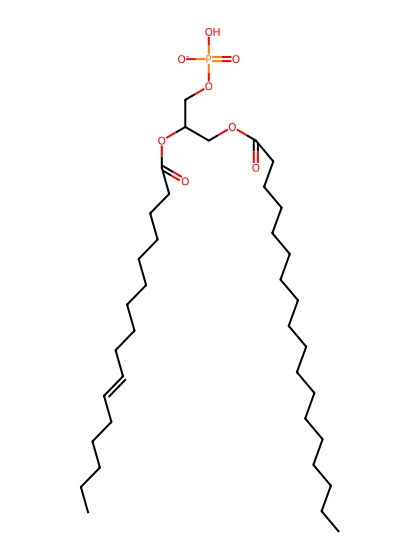
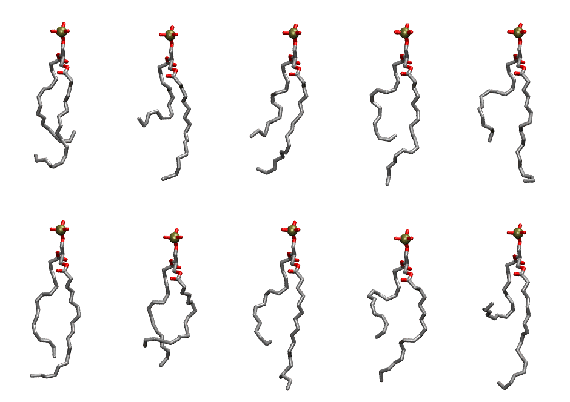

.. _lipid_gallery tipa:

TIPA
====

==============  ========================================
CHARMM resname  ``TIPA``
Net charge      -1.00
Atoms           106
Topology file   ``toppar_all36_lipid_miscellaneous.str``
Conformers      10 fluid
==============  ========================================

Structure
---------

Conformers
----------

The grid packer draws a conformer per lipid from this ensemble, so what the ensemble contains is what a built bilayer is made of. A leaflet declared ``phase: Lo`` generates an ordered ensemble when a build first needs it. All conformers are rendered at one shared scale.

===========  =============  ================  ================
Conformer    Head-tail (Å)  Max internal (Å)  Min chain extent
===========  =============  ================  ================
``TIPA-00``  9.08           23.86             0.58
``TIPA-01``  6.50           25.19             0.44
``TIPA-02``  9.49           24.98             0.60
``TIPA-03``  9.45           26.27             0.60
``TIPA-04``  10.28          25.93             0.64
``TIPA-05``  13.11          25.91             0.74
``TIPA-06``  10.22          23.02             0.47
``TIPA-07``  10.78          27.14             0.67
``TIPA-08``  8.74           25.18             0.56
``TIPA-09``  4.49           26.68             0.34
===========  =============  ================  ================

*Min chain extent* is how far the least-extended acyl chain descends below its own attachment carbon, as a fraction of that chain's all-trans contour; an all-trans chain scores 1.0, and a conformer under 0.25 is rejected at generation as folded.

Provenance
----------

How the ensemble was generated, read from the entry's own ``info.yaml``:

===================  ============
Setting              ``TIPA``
===================  ============
Sampler              ``mc``
Phase                none (fluid)
Trans bias           0.0
Chain order          0.167
MC seed              0
Chains               2
Cylinder APL         60.0 Ų
Cylinder inflation   1.9
Equilibration steps  20000
Decorrelation steps  3000
Max MC angle         30°
Radius scale         0.8
Axial bias           1.0
===================  ============
