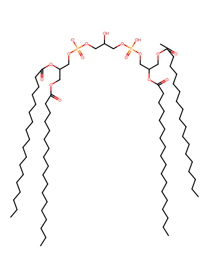
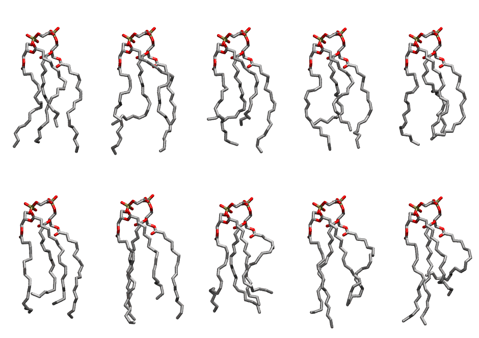

.. _lipid_gallery tlcl1:

TLCL1
=====

**Tetralinoleoyl Cardiolipin with head group charge = -1**

==============  ======================================
CHARMM resname  ``TLCL1``
Net charge      -1.00
Atoms           241
Topology file   ``toppar_all36_lipid_cardiolipin.str``
Conformers      10 fluid
==============  ======================================

Structure
---------

Conformers
----------

The grid packer draws a conformer per lipid from this ensemble, so what the ensemble contains is what a built bilayer is made of. A leaflet declared ``phase: Lo`` generates an ordered ensemble when a build first needs it. All conformers are rendered at one shared scale.

============  =============  ================  ================
Conformer     Head-tail (Å)  Max internal (Å)  Min chain extent
============  =============  ================  ================
``TLCL1-00``  11.30          26.65             0.70
``TLCL1-01``  10.84          26.76             0.62
``TLCL1-02``  9.86           25.75             0.57
``TLCL1-03``  10.74          26.22             0.61
``TLCL1-04``  12.34          24.70             0.68
``TLCL1-05``  11.10          25.63             0.63
``TLCL1-06``  12.26          27.48             0.75
``TLCL1-07``  10.52          24.10             0.64
``TLCL1-08``  12.95          28.68             0.64
``TLCL1-09``  7.29           27.67             0.38
============  =============  ================  ================

*Min chain extent* is how far the least-extended acyl chain descends below its own attachment carbon, as a fraction of that chain's all-trans contour; an all-trans chain scores 1.0, and a conformer under 0.25 is rejected at generation as folded.

Provenance
----------

How the ensemble was generated, read from the entry's own ``info.yaml``:

===================  ============
Setting              ``TLCL1``
===================  ============
Sampler              ``mc``
Phase                none (fluid)
Trans bias           0.0
Chain order          0.157
MC seed              0
Chains               4
Cylinder APL         120.0 Ų
Cylinder inflation   1.9
Equilibration steps  20000
Decorrelation steps  3000
Max MC angle         30°
Radius scale         0.8
Axial bias           1.0
===================  ============
