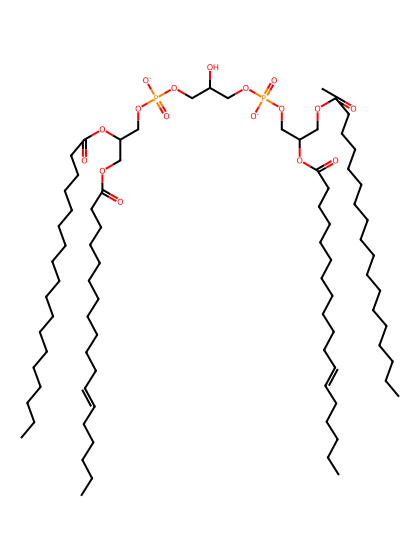
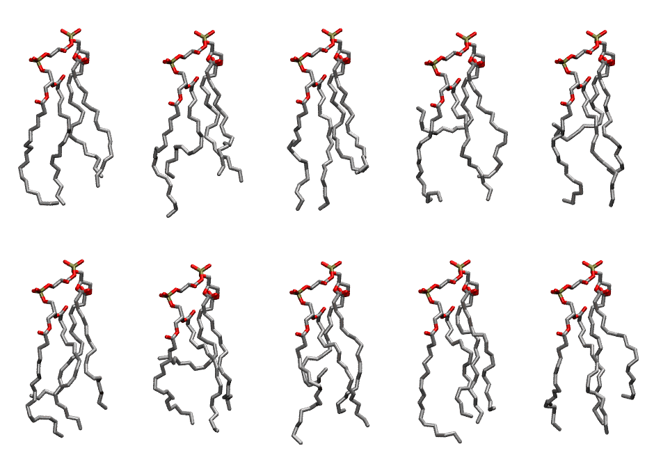

.. _lipid_gallery tlcl2:

TLCL2
=====

**Tetralinoleoyl Cardiolipin with head group charge = -2**

==============  ======================================
CHARMM resname  ``TLCL2``
Net charge      -2.00
Atoms           240
Topology file   ``toppar_all36_lipid_cardiolipin.str``
Conformers      10 fluid
==============  ======================================

Structure
---------

Conformers
----------

The grid packer draws a conformer per lipid from this ensemble, so what the ensemble contains is what a built bilayer is made of. A leaflet declared ``phase: Lo`` generates an ordered ensemble when a build first needs it. All conformers are rendered at one shared scale.

============  =============  ================  ================
Conformer     Head-tail (Å)  Max internal (Å)  Min chain extent
============  =============  ================  ================
``TLCL2-00``  11.01          27.05             0.68
``TLCL2-01``  10.46          28.78             0.63
``TLCL2-02``  9.56           27.99             0.71
``TLCL2-03``  0.47           26.62             0.29
``TLCL2-04``  3.12           27.03             0.41
``TLCL2-05``  9.31           27.41             0.69
``TLCL2-06``  3.14           26.36             0.41
``TLCL2-07``  5.19           28.34             0.50
``TLCL2-08``  11.08          27.46             0.70
``TLCL2-09``  9.17           27.20             0.64
============  =============  ================  ================

*Min chain extent* is how far the least-extended acyl chain descends below its own attachment carbon, as a fraction of that chain's all-trans contour; an all-trans chain scores 1.0, and a conformer under 0.25 is rejected at generation as folded.

Provenance
----------

How the ensemble was generated, read from the entry's own ``info.yaml``:

===================  ============
Setting              ``TLCL2``
===================  ============
Sampler              ``mc``
Phase                none (fluid)
Trans bias           0.0
Chain order          0.186
MC seed              0
Chains               4
Cylinder APL         120.0 Ų
Cylinder inflation   1.9
Equilibration steps  20000
Decorrelation steps  3000
Max MC angle         30°
Radius scale         0.8
Axial bias           1.0
===================  ============
