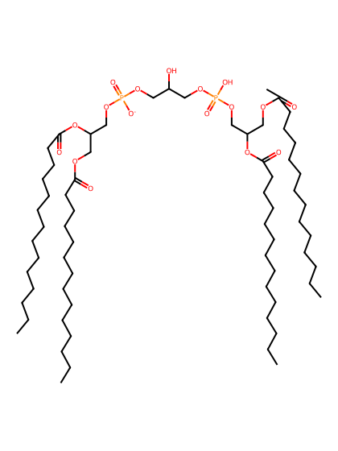
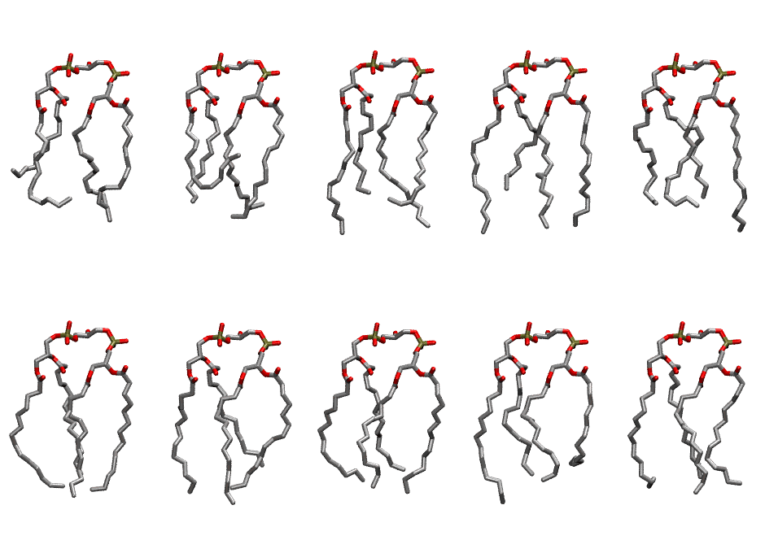
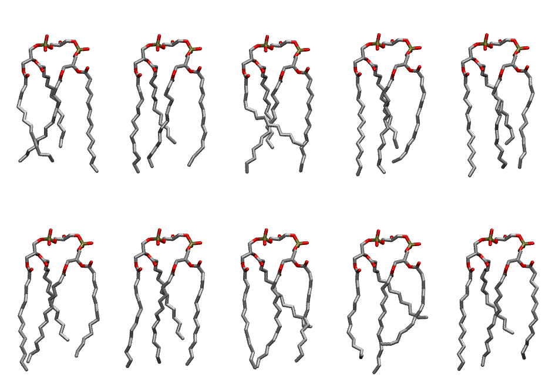

.. _lipid_gallery tmcl1:

TMCL1
=====

**Tetramyristoyl Cardiolipin with head group charge = -1**

==============  ===========================================
CHARMM resname  ``TMCL1``
Net charge      -1.00
Atoms           209
Topology file   ``toppar_all36_lipid_cardiolipin.str``
Conformers      10 fluid, 10 liquid-ordered (``TMCL1__Lo``)
==============  ===========================================

Structure
---------

Conformers
----------

The grid packer draws a conformer per lipid from an ensemble, so what the ensemble contains is what a built bilayer is made of. TMCL1 ships two: a fluid one, used by default, and a liquid-ordered one, used for a leaflet declared ``phase: Lo``. All conformers on this page are rendered at one shared scale.

Fluid (``TMCL1``)
~~~~~~~~~~~~~~~~~

============  =============  ================  ================
Conformer     Head-tail (Å)  Max internal (Å)  Min chain extent
============  =============  ================  ================
``TMCL1-00``  6.32           20.93             0.52
``TMCL1-01``  4.57           21.20             0.31
``TMCL1-02``  9.26           23.48             0.69
``TMCL1-03``  8.81           23.98             0.67
``TMCL1-04``  9.47           23.50             0.64
``TMCL1-05``  10.56          22.92             0.77
``TMCL1-06``  9.29           22.91             0.70
``TMCL1-07``  9.86           21.18             0.71
``TMCL1-08``  9.23           23.22             0.64
``TMCL1-09``  10.83          21.84             0.71
============  =============  ================  ================

Liquid-ordered (``TMCL1__Lo``)
~~~~~~~~~~~~~~~~~~~~~~~~~~~~~~

============  =============  ================  ================
Conformer     Head-tail (Å)  Max internal (Å)  Min chain extent
============  =============  ================  ================
``TMCL1-00``  10.83          24.57             0.80
``TMCL1-01``  10.26          24.42             0.76
``TMCL1-02``  10.54          24.35             0.68
``TMCL1-03``  11.19          25.46             0.82
``TMCL1-04``  10.55          25.08             0.78
``TMCL1-05``  10.74          25.69             0.79
``TMCL1-06``  10.55          24.88             0.78
``TMCL1-07``  8.58           25.17             0.66
``TMCL1-08``  6.86           24.76             0.56
``TMCL1-09``  9.57           25.46             0.72
============  =============  ================  ================

*Min chain extent* is how far the least-extended acyl chain descends below its own attachment carbon, as a fraction of that chain's all-trans contour; an all-trans chain scores 1.0, and a conformer under 0.25 is rejected at generation as folded.

Provenance
----------

How each ensemble was generated, read from the entry's own ``info.yaml``:

===================  ============  =============
Setting              ``TMCL1``     ``TMCL1__Lo``
===================  ============  =============
Sampler              ``mc``        ``mc``
Phase                none (fluid)  Lo
Trans bias           0.0           7.5
Chain order          0.187         0.300
MC seed              0             0
Chains               4             4
Cylinder APL         120.0 Ų      120.0 Ų
Cylinder inflation   1.9           1.9
Equilibration steps  20000         20000
Decorrelation steps  3000          3000
Max MC angle         30°           30°
Radius scale         0.8           0.8
Axial bias           1.0           1.0
===================  ============  =============
