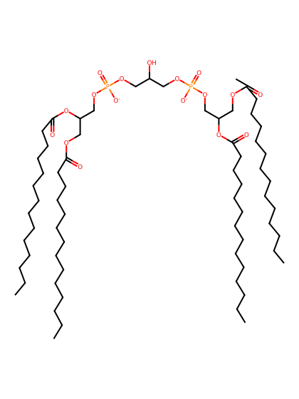
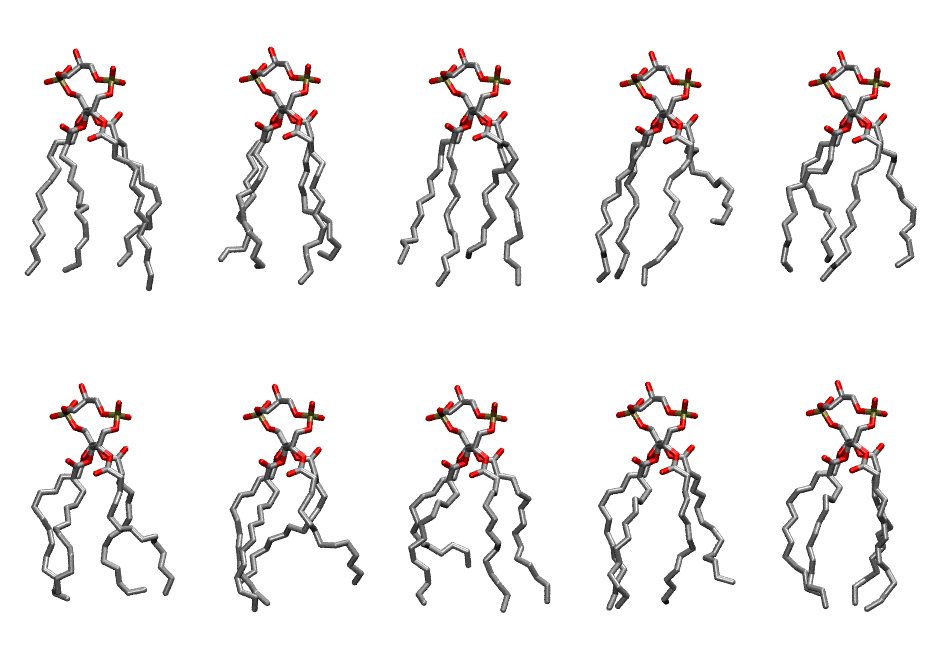
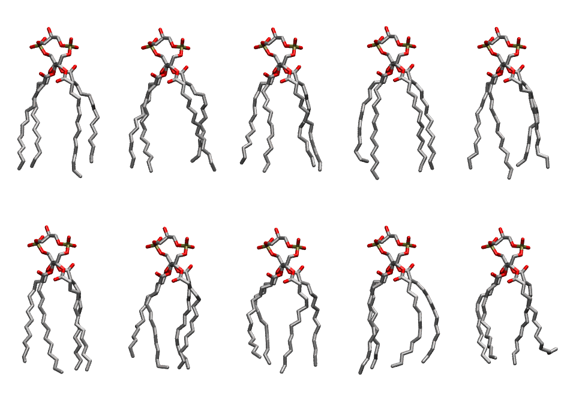

.. _lipid_gallery tmcl2:

TMCL2
=====

**Tetramyristoyl Cardiolipin with head group charge = -2**

==============  ===========================================
CHARMM resname  ``TMCL2``
Net charge      -2.00
Atoms           208
Topology file   ``toppar_all36_lipid_cardiolipin.str``
Conformers      10 fluid, 10 liquid-ordered (``TMCL2__Lo``)
==============  ===========================================

Structure
---------

Conformers
----------

The grid packer draws a conformer per lipid from an ensemble, so what the ensemble contains is what a built bilayer is made of. TMCL2 ships two: a fluid one, used by default, and a liquid-ordered one, used for a leaflet declared ``phase: Lo``. All conformers on this page are rendered at one shared scale.

Fluid (``TMCL2``)
~~~~~~~~~~~~~~~~~

============  =============  ================  ================
Conformer     Head-tail (Å)  Max internal (Å)  Min chain extent
============  =============  ================  ================
``TMCL2-00``  11.90          24.97             0.80
``TMCL2-01``  11.05          24.21             0.76
``TMCL2-02``  11.22          24.09             0.77
``TMCL2-03``  7.58           23.68             0.55
``TMCL2-04``  11.37          23.27             0.76
``TMCL2-05``  11.06          22.50             0.71
``TMCL2-06``  10.12          22.75             0.65
``TMCL2-07``  8.55           23.18             0.59
``TMCL2-08``  10.47          23.20             0.72
``TMCL2-09``  11.70          23.10             0.78
============  =============  ================  ================

Liquid-ordered (``TMCL2__Lo``)
~~~~~~~~~~~~~~~~~~~~~~~~~~~~~~

============  =============  ================  ================
Conformer     Head-tail (Å)  Max internal (Å)  Min chain extent
============  =============  ================  ================
``TMCL2-00``  12.76          25.62             0.86
``TMCL2-01``  12.55          25.06             0.85
``TMCL2-02``  12.90          24.97             0.85
``TMCL2-03``  12.87          24.86             0.85
``TMCL2-04``  13.36          24.86             0.85
``TMCL2-05``  12.98          25.22             0.86
``TMCL2-06``  11.94          23.80             0.79
``TMCL2-07``  11.93          24.17             0.76
``TMCL2-08``  12.99          24.42             0.86
``TMCL2-09``  10.72          23.01             0.68
============  =============  ================  ================

*Min chain extent* is how far the least-extended acyl chain descends below its own attachment carbon, as a fraction of that chain's all-trans contour; an all-trans chain scores 1.0, and a conformer under 0.25 is rejected at generation as folded.

Provenance
----------

How each ensemble was generated, read from the entry's own ``info.yaml``:

===================  ============  =============
Setting              ``TMCL2``     ``TMCL2__Lo``
===================  ============  =============
Sampler              ``mc``        ``mc``
Phase                none (fluid)  Lo
Trans bias           0.0           5.0
Chain order          0.208         0.303
MC seed              0             0
Chains               4             4
Cylinder APL         120.0 Ų      120.0 Ų
Cylinder inflation   1.9           1.9
Equilibration steps  20000         20000
Decorrelation steps  3000          3000
Max MC angle         30°           30°
Radius scale         0.8           0.8
Axial bias           1.0           1.0
===================  ============  =============
