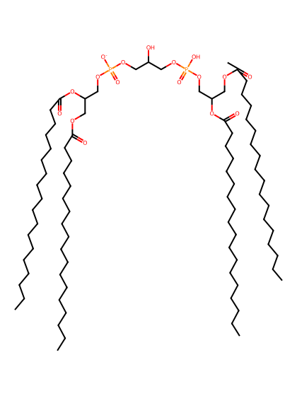
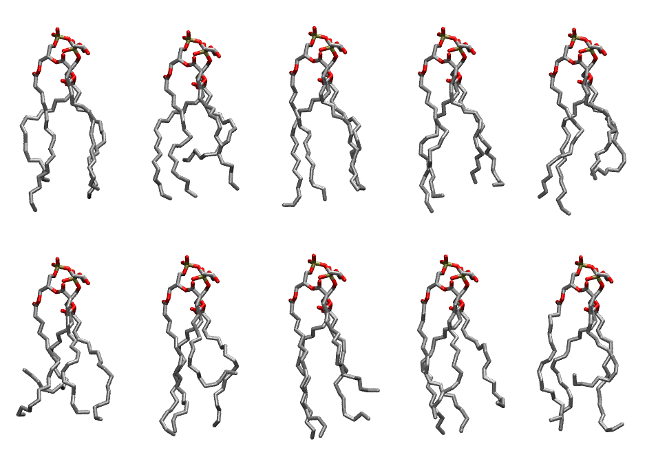

.. _lipid_gallery tocl1:

TOCL1
=====

**Tetraoleoyl Cardiolipin with head group charge = -1**

==============  ======================================
CHARMM resname  ``TOCL1``
Net charge      -1.00
Atoms           249
Topology file   ``toppar_all36_lipid_cardiolipin.str``
Conformers      10 fluid
==============  ======================================

Structure
---------

Conformers
----------

The grid packer draws a conformer per lipid from this ensemble, so what the ensemble contains is what a built bilayer is made of. A leaflet declared ``phase: Lo`` generates an ordered ensemble when a build first needs it. All conformers are rendered at one shared scale.

============  =============  ================  ================
Conformer     Head-tail (Å)  Max internal (Å)  Min chain extent
============  =============  ================  ================
``TOCL1-00``  13.57          27.06             0.64
``TOCL1-01``  10.37          25.30             0.48
``TOCL1-02``  14.97          27.18             0.69
``TOCL1-03``  14.02          27.64             0.67
``TOCL1-04``  12.71          27.48             0.59
``TOCL1-05``  7.96           24.79             0.38
``TOCL1-06``  8.70           26.80             0.56
``TOCL1-07``  11.36          27.51             0.68
``TOCL1-08``  13.06          27.16             0.60
``TOCL1-09``  8.94           26.32             0.57
============  =============  ================  ================

*Min chain extent* is how far the least-extended acyl chain descends below its own attachment carbon, as a fraction of that chain's all-trans contour; an all-trans chain scores 1.0, and a conformer under 0.25 is rejected at generation as folded.

Provenance
----------

How the ensemble was generated, read from the entry's own ``info.yaml``:

===================  ============
Setting              ``TOCL1``
===================  ============
Sampler              ``mc``
Phase                none (fluid)
Trans bias           0.0
Chain order          0.192
MC seed              0
Chains               4
Cylinder APL         120.0 Ų
Cylinder inflation   1.9
Equilibration steps  20000
Decorrelation steps  3000
Max MC angle         30°
Radius scale         0.8
Axial bias           1.0
===================  ============
