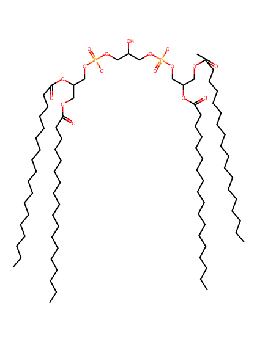
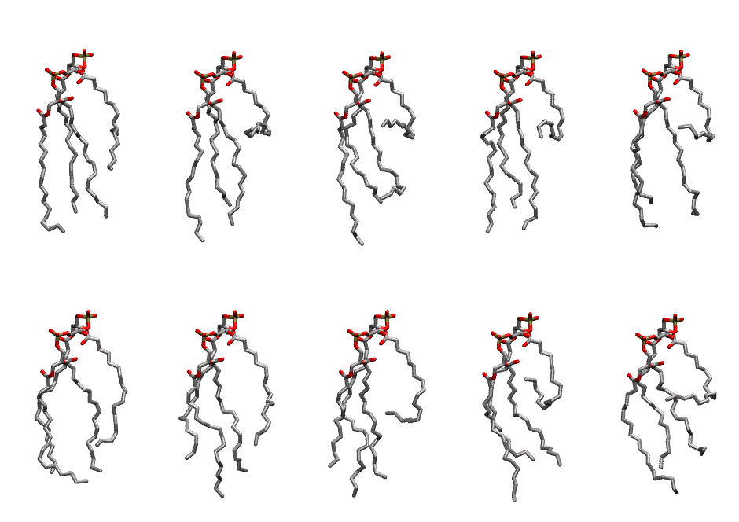

.. _lipid_gallery tocl2:

TOCL2
=====

**Tetraoleoyl Cardiolipin with head group charge = -2**

==============  ======================================
CHARMM resname  ``TOCL2``
Net charge      -2.00
Atoms           248
Topology file   ``toppar_all36_lipid_cardiolipin.str``
Conformers      10 fluid
==============  ======================================

Structure
---------

Conformers
----------

The grid packer draws a conformer per lipid from this ensemble, so what the ensemble contains is what a built bilayer is made of. A leaflet declared ``phase: Lo`` generates an ordered ensemble when a build first needs it. All conformers are rendered at one shared scale.

============  =============  ================  ================
Conformer     Head-tail (Å)  Max internal (Å)  Min chain extent
============  =============  ================  ================
``TOCL2-00``  8.55           28.27             0.63
``TOCL2-01``  2.46           29.69             0.34
``TOCL2-02``  1.83           29.64             0.32
``TOCL2-03``  3.57           28.38             0.40
``TOCL2-04``  2.35           27.48             0.34
``TOCL2-05``  10.83          26.27             0.71
``TOCL2-06``  10.66          28.37             0.72
``TOCL2-07``  6.12           28.64             0.51
``TOCL2-08``  0.81           29.52             0.27
``TOCL2-09``  3.58           27.52             0.40
============  =============  ================  ================

*Min chain extent* is how far the least-extended acyl chain descends below its own attachment carbon, as a fraction of that chain's all-trans contour; an all-trans chain scores 1.0, and a conformer under 0.25 is rejected at generation as folded.

Provenance
----------

How the ensemble was generated, read from the entry's own ``info.yaml``:

===================  ============
Setting              ``TOCL2``
===================  ============
Sampler              ``mc``
Phase                none (fluid)
Trans bias           0.0
Chain order          0.189
MC seed              0
Chains               4
Cylinder APL         120.0 Ų
Cylinder inflation   1.9
Equilibration steps  20000
Decorrelation steps  3000
Max MC angle         30°
Radius scale         0.8
Axial bias           1.0
===================  ============
