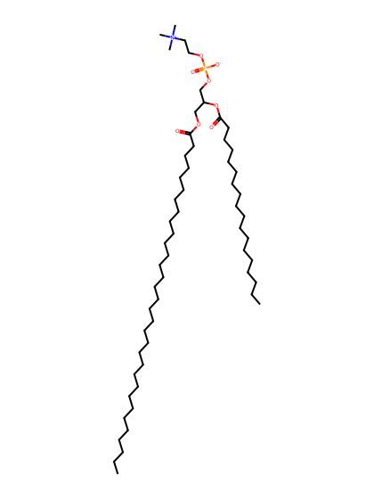
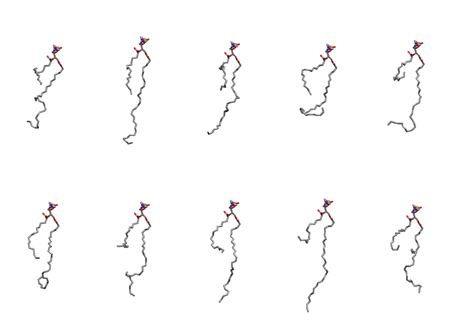

.. _lipid_gallery tspc:

TSPC
====

**3-dotricontahexaenoyl-2-stearoyl-D-glycero-1-phosphatidylcholine**

==============  ========================================
CHARMM resname  ``TSPC``
Net charge      0.00
Atoms           172
Topology file   ``toppar_all36_lipid_miscellaneous.str``
Conformers      10 fluid
==============  ========================================

Structure
---------

Conformers
----------

The grid packer draws a conformer per lipid from this ensemble, so what the ensemble contains is what a built bilayer is made of. A leaflet declared ``phase: Lo`` generates an ordered ensemble when a build first needs it. All conformers are rendered at one shared scale.

===========  =============  ================  ================
Conformer    Head-tail (Å)  Max internal (Å)  Min chain extent
===========  =============  ================  ================
``TSPC-00``  6.65           30.80             0.40
``TSPC-01``  12.84          39.09             0.69
``TSPC-02``  9.79           34.81             0.55
``TSPC-03``  10.48          27.38             0.38
``TSPC-04``  4.18           33.30             0.29
``TSPC-05``  12.38          31.79             0.48
``TSPC-06``  8.36           34.86             0.48
``TSPC-07``  11.00          37.03             0.61
``TSPC-08``  6.15           41.34             0.38
``TSPC-09``  7.26           31.52             0.43
===========  =============  ================  ================

*Min chain extent* is how far the least-extended acyl chain descends below its own attachment carbon, as a fraction of that chain's all-trans contour; an all-trans chain scores 1.0, and a conformer under 0.25 is rejected at generation as folded.

Provenance
----------

How the ensemble was generated, read from the entry's own ``info.yaml``:

===================  ============
Setting              ``TSPC``
===================  ============
Sampler              ``mc``
Phase                none (fluid)
Trans bias           0.0
Chain order          0.116
MC seed              0
Chains               2
Cylinder APL         60.0 Ų
Cylinder inflation   1.9
Equilibration steps  20000
Decorrelation steps  3000
Max MC angle         30°
Radius scale         0.8
Axial bias           1.0
===================  ============
