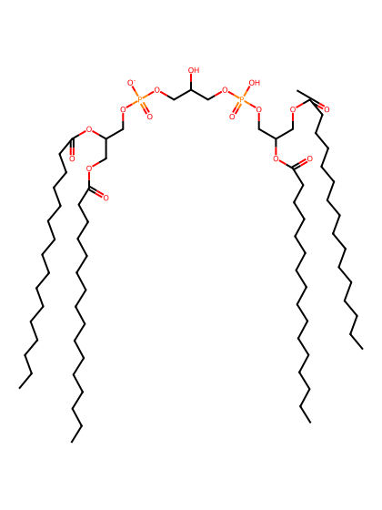
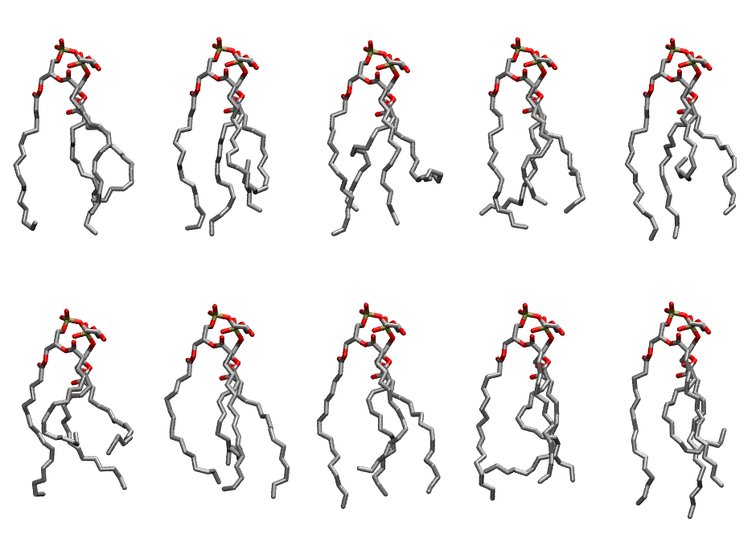

.. _lipid_gallery tycl1:

TYCL1
=====

**Tetra-hexadecenoyl Cardiolipin with head group charge = -1**

==============  ======================================
CHARMM resname  ``TYCL1``
Net charge      -1.00
Atoms           225
Topology file   ``toppar_all36_lipid_cardiolipin.str``
Conformers      10 fluid
==============  ======================================

Structure
---------

Conformers
----------

The grid packer draws a conformer per lipid from this ensemble, so what the ensemble contains is what a built bilayer is made of. A leaflet declared ``phase: Lo`` generates an ordered ensemble when a build first needs it. All conformers are rendered at one shared scale.

============  =============  ================  ================
Conformer     Head-tail (Å)  Max internal (Å)  Min chain extent
============  =============  ================  ================
``TYCL1-00``  10.47          25.47             0.56
``TYCL1-01``  5.97           24.97             0.33
``TYCL1-02``  7.67           24.31             0.42
``TYCL1-03``  10.95          23.53             0.64
``TYCL1-04``  5.57           25.30             0.50
``TYCL1-05``  6.11           23.91             0.45
``TYCL1-06``  10.17          24.84             0.59
``TYCL1-07``  10.91          24.84             0.73
``TYCL1-08``  11.24          24.30             0.60
``TYCL1-09``  6.49           27.49             0.39
============  =============  ================  ================

*Min chain extent* is how far the least-extended acyl chain descends below its own attachment carbon, as a fraction of that chain's all-trans contour; an all-trans chain scores 1.0, and a conformer under 0.25 is rejected at generation as folded.

Provenance
----------

How the ensemble was generated, read from the entry's own ``info.yaml``:

===================  ============
Setting              ``TYCL1``
===================  ============
Sampler              ``mc``
Phase                none (fluid)
Trans bias           0.0
Chain order          0.190
MC seed              0
Chains               4
Cylinder APL         120.0 Ų
Cylinder inflation   1.9
Equilibration steps  20000
Decorrelation steps  3000
Max MC angle         30°
Radius scale         0.8
Axial bias           1.0
===================  ============
