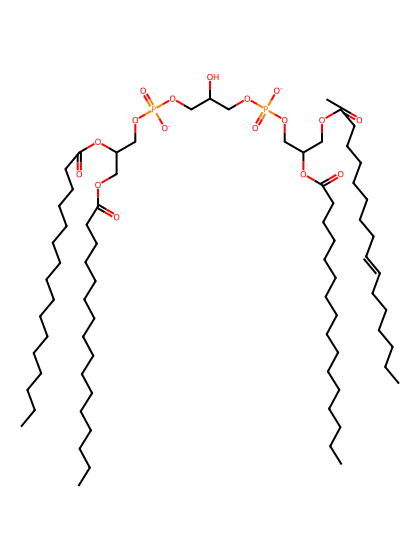
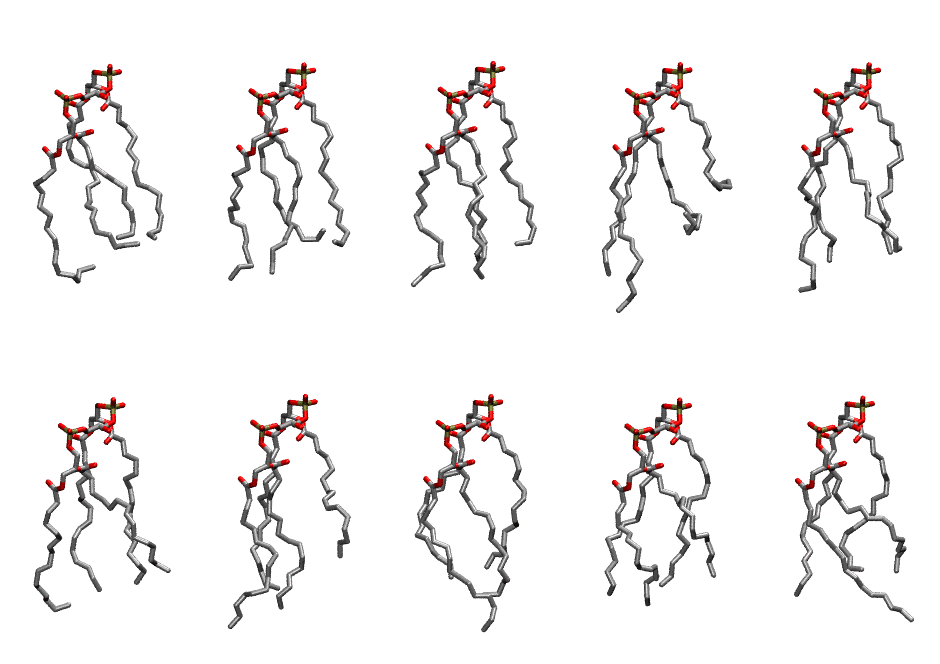

.. _lipid_gallery tycl2:

TYCL2
=====

**Tetra-hexadecenoyl Cardiolipin with head group charge = -2**

==============  ======================================
CHARMM resname  ``TYCL2``
Net charge      -2.00
Atoms           224
Topology file   ``toppar_all36_lipid_cardiolipin.str``
Conformers      10 fluid
==============  ======================================

Structure
---------

Conformers
----------

The grid packer draws a conformer per lipid from this ensemble, so what the ensemble contains is what a built bilayer is made of. A leaflet declared ``phase: Lo`` generates an ordered ensemble when a build first needs it. All conformers are rendered at one shared scale.

============  =============  ================  ================
Conformer     Head-tail (Å)  Max internal (Å)  Min chain extent
============  =============  ================  ================
``TYCL2-00``  9.47           24.17             0.61
``TYCL2-01``  8.89           24.80             0.69
``TYCL2-02``  10.44          25.88             0.73
``TYCL2-03``  3.57           28.24             0.45
``TYCL2-04``  10.79          25.93             0.65
``TYCL2-05``  9.43           24.96             0.57
``TYCL2-06``  8.21           26.73             0.69
``TYCL2-07``  9.37           26.44             0.73
``TYCL2-08``  9.88           23.33             0.60
``TYCL2-09``  9.46           25.93             0.58
============  =============  ================  ================

*Min chain extent* is how far the least-extended acyl chain descends below its own attachment carbon, as a fraction of that chain's all-trans contour; an all-trans chain scores 1.0, and a conformer under 0.25 is rejected at generation as folded.

Provenance
----------

How the ensemble was generated, read from the entry's own ``info.yaml``:

===================  ============
Setting              ``TYCL2``
===================  ============
Sampler              ``mc``
Phase                none (fluid)
Trans bias           0.0
Chain order          0.193
MC seed              0
Chains               4
Cylinder APL         120.0 Ų
Cylinder inflation   1.9
Equilibration steps  20000
Decorrelation steps  3000
Max MC angle         30°
Radius scale         0.8
Axial bias           1.0
===================  ============
