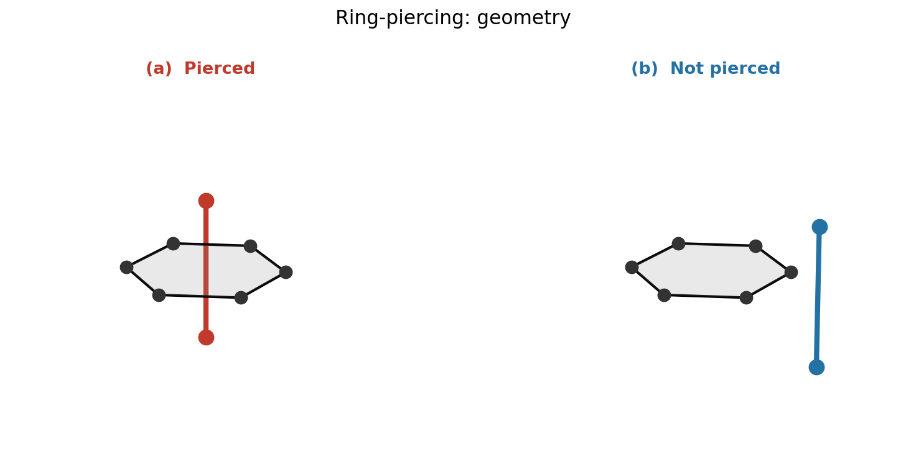
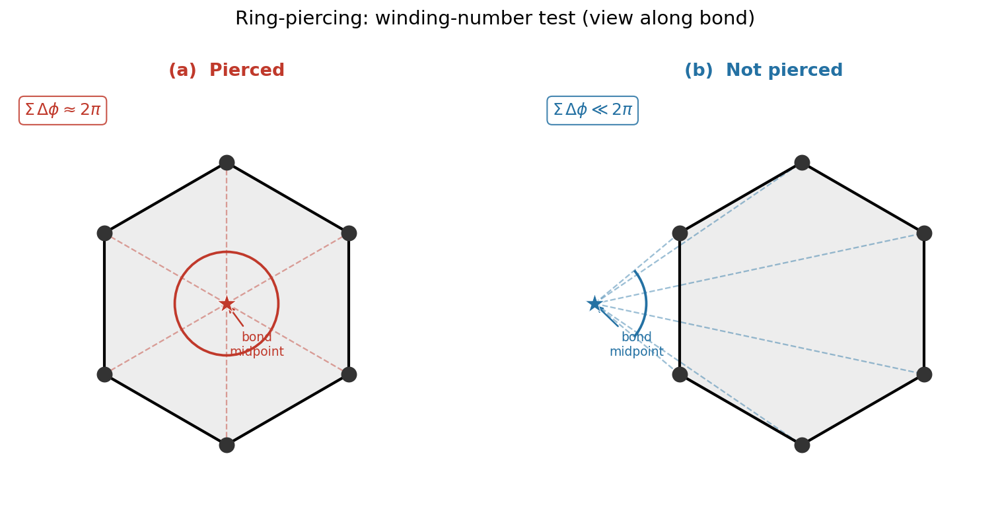
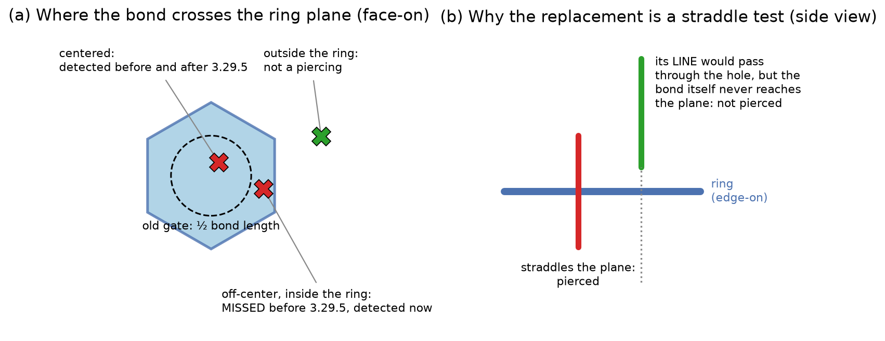
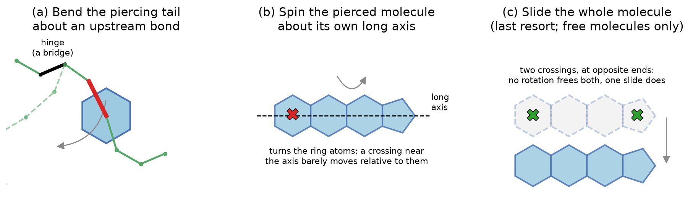
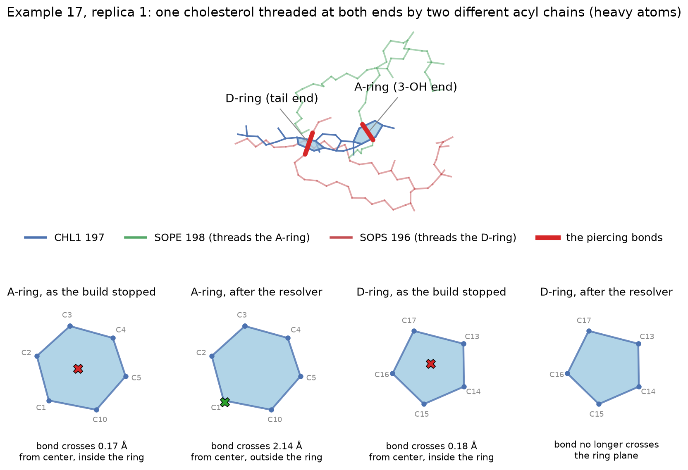
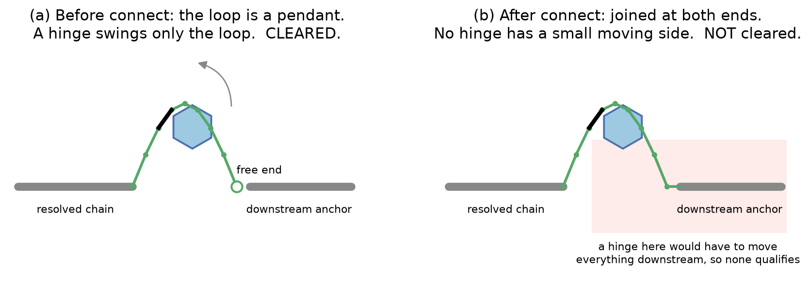
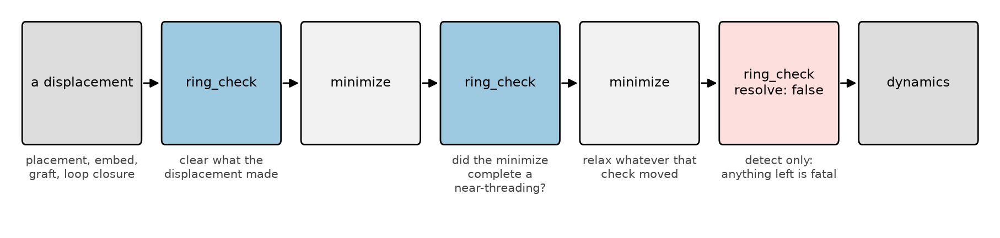

.. _pierced_rings:

Pierced rings: how pestifer finds and resolves them
===================================================

A **pierced ring** is a configuration in which a covalent bond passes through the interior of a
ring belonging to another molecule (or another part of the same one). The usual cases are an
acyl chain threaded through a cholesterol ring in a membrane, a glycan bond threaded through a
protein side-chain ring or another sugar, and a modeled loop threaded through an aromatic side
chain.

pestifer treats a pierced ring as a **build failure**, not a crash risk. Once a bond sits on the
wrong side of a ring, neither minimization nor any amount of dynamics puts it back: the
threading is topological, so it propagates through however many microseconds of production
follow, whether or not the integrator ever complains. Sometimes it does complain (a RATTLE
failure on the first dynamics step), and sometimes the system runs happily on the wrong
chemistry. Either way the structure is wrong.

This page explains where piercings come from, how pestifer detects them, the moves it uses to
undo them, where in a build those checks run, and what happens when a piercing cannot be
resolved. The task-level reference is :ref:`subs_buildtasks_ring_check`.

.. contents:: On this page
   :local:
   :depth: 1

Where piercings come from
-------------------------

A piercing is made by an **unphysical displacement**: something that moves atoms without
integrating equations of motion, and so does not have to respect the energy barrier a bond
would have to cross to enter a ring. In pestifer those are:

- **Initial placement**: packing lipids onto a grid in ``make_membrane_system``.
- **Embedding**: inserting a protein into a relaxed bilayer.
- **Grafting**: adding glycans and modeling missing terminal tails in ``psfgen``.
- **Loop closure**: ``ligate`` closing a modeled loop onto its downstream anchor.
- **The resolver's own moves**, described below.

**Dynamics cannot create a piercing.** Pushing an atom through a ring costs tens of kcal/mol
against a thermal energy of about 0.6 kcal/mol at membrane temperatures. **A minimizer can
finish one.** It has no kinetic energy to respect a barrier with, and when it relieves a large
overlap it can complete a near-threading on the way down. On an example-17 calibration patch,
comparing the piercing *sets* rather than counts, one minimization cleared three piercings and
created two. That is why pestifer checks on both sides of a minimization (see
:ref:`pierced_rings_where`).

Detection
---------

For every ring of the requested segment types (rings of up to ``max_ring_size`` atoms, default
7), pestifer gathers candidate bonds whose midpoints lie within ``cutoff`` (default 4.0 Å) of the
ring's center. A candidate pierces the ring when **both** of the following hold:

1. **It straddles the ring.** The two bond atoms lie on opposite sides of the ring's mean plane.
2. **It passes through the inside.** When the ring atoms are projected onto the plane
   perpendicular to the bond at the bond's midpoint, the angles they subtend at the midpoint sum
   to 2π (the winding-number test).

Together these mean the bond *segment* crosses the ring plane *inside* the ring, anywhere inside.

   **Side view.** Left: a bond (red) passes through the ring, a piercing. Right: the bond (blue)
   passes beside it.

   **The winding-number test**, viewed along the bond. Left: the bond midpoint (star) is inside
   the projected ring, so the subtended angles sum to 2π. Right: it is outside, and they do not.

         contrasting a straddling bond with one that only points at the ring.

   **(a)** Before version 3.29.5, step 1 was a distance gate instead: a bond was rejected unless
   its midpoint lay within half a bond length of the ring center (dashed circle). Off-center
   threadings inside the ring were invisible. **(b)** Simply removing the gate would also be
   wrong. A bond pointing at the hole from one side has a *line* that threads the ring and a
   *segment* that does not, and only a straddle test tells them apart.

.. note::

   **Why the old gate mattered, and how it was found.** Threadings that come out of a build
   tend to sit near the ring center. The minimizer also stretches the threaded bond, which
   widens a gate defined by bond length: in example 17 the threaded C–C bonds measured 2.5–2.9 Å
   against a normal 1.53 Å. So on fresh build output the gate rarely missed anything. It
   mattered once the resolver started making small moves, which push a centered crossing
   off-center. In version 3.29.4 the resolver reported six of six piercings cleared on an
   example-17 bilayer, and three were still threaded. The resolver judges its own candidate
   poses with the same detector, so it found poses the detector could not see. Version 3.29.5
   replaced the gate with the straddle test. On the same structure, an independent check that
   shares no code with the detector (segment–plane intersection plus a ray cast) confirms six
   threaded before resolution and none after.

Resolution
----------

What pestifer does with a piercing depends on what kind of ring is pierced and what kind of bond
is doing the piercing.

.. list-table::
   :header-rows: 1
   :widths: 30 70

   * - Piercing
     - Moves tried, in order
   * - Aromatic protein ring (His, Phe, Tyr, Trp)
     - Rotate the side chain about χ2, then χ1.
   * - Proline or glycan ring, pierced by a glycan bond
     - Rotate the glycan branch that carries the piercing bond.
   * - Glycan ring, pierced by a protein side chain
     - Rotate the glycan branch carrying the pierced ring, then the side chain.
   * - **Lipid ring, pierced by a lipid bond** (a sterol threaded by an acyl chain)
     - Bend the piercing tail; then spin the sterol; then slide it.
   * - Lipid ring, pierced by a protein bond
     - Spin the sterol; then rotate the protein side chain; then slide the sterol.

If no move clears it, a piercing of a **lipid** ring is handled by the ``delete`` setting (see
`When a piercing cannot be resolved`_). A remaining piercing that involves **protein or glycan**
on either side is always fatal: those molecules are never deleted.

The three moves for a lipid ring are shown here:

         long axis, and sliding a sterol sideways.

   **(a)** Bend the piercing chain. Rotate the part of the chain beyond the piercing bond about
   an upstream bond whose removal would split the molecule (a graph *bridge*). Small and local.
   **(b)** Spin the pierced sterol about its own long axis. This turns the ring atoms, but a
   crossing near the axis barely moves relative to them, so it clears bonds near a ring's rim
   better than bonds through its center. **(c)** Slide the whole pierced molecule. This is the
   only move that frees a molecule pierced at two points, and it is tried last because it moves
   the most atoms.

Every move is judged the same way, in this order:

1. **Does it clear the piercing?** The candidate is re-checked with the detector above.
2. **Is it eligible?** A pose that puts any pair of heavy atoms closer than 1.2 Å (the steric
   gate's threshold) is rejected outright. The steric gate before dynamics would refuse it
   anyway, and accepting it would waste the chance to try another hinge.
3. **Among eligible poses, the fewest new soft contacts wins.** For the slide, the smallest
   displacement that yields any eligible pose wins, so the molecule moves as little as possible.

The search over directions and angles is deterministic, so a rerun on the same input gives the
same answer.

**The slide only ever moves a free molecule.** Translating one residue inside a covalent chain
would stretch the bonds on either side of it into nonsense, so the slide refuses any residue
with a bond leaving it. In a bilayer each lipid is its own molecule and passes this test. A
protein or glycan residue does not, so its piercing is reported instead of shoved aside.

**In a membrane build, a protein–lipid piercing points at the embed.** For a bond to thread a
ring it must pass about 1.6 Å from a ring atom, well inside the 2.89 Å carbon–carbon distance at
which ``bilayer_embed`` deletes an overlapping lipid. A working embed therefore cannot leave one,
and the error message says so: an unresolvable piercing between protein and lipid is a report
that the embed's clash deletion is not working.

A worked case: example 17, replica 1
------------------------------------

The 3.29.3 example sweep stopped one replica of example 17 with three piercings that no rotation
could clear. One cholesterol was threaded at **both** ends, through two different rings by two
different acyl chains:

         face-on views of each ring before and after resolution.

   **Top:** CHL1 197 (blue), SOPE 198 (green) threading its A-ring at the 3-OH end, and SOPS 196
   (red) threading its D-ring at the tail end, heavy atoms only, with the piercing bonds in bold
   red. **Bottom:** each ring face-on, marking where the piercing bond crosses the ring plane.
   As the build stopped, both bonds crossed within 0.2 Å of a ring center. After the 3.29.5
   resolver, the A-ring bond crosses outside the ring, and the D-ring bond no longer reaches the
   plane at all. Coordinates are from the actual build. The script that draws this figure and
   the data it reads live in ``docs/source/figs/pierced-rings/``.

Why rotation could not fix this: the sterol's long axis runs near both ring centers, so a spin
moves neither hole relative to its bond. Bending either acyl chain leaves the other one still
holding the ring. Of 903 and 917 candidate tail rotations, not one cleared the A-ring or the
D-ring piercing respectively. A rigid slide moves both rings off both bonds at once: the
resolver slid this sterol 2.0 Å. After that, the second threading cleared with an ordinary tail
rotation.

This replica also exposed a second, quieter failure. Another cholesterol in the same leaflet
(CHL1 162) was pierced at only one point and *did* have clearing rotations, two of them against
the unmodified structure. It lost them anyway. The resolver works through the piercings one at a
time, and each accepted pose may leave a few soft contacts. By the time it reached CHL1 162, the
rotations already applied around it had removed both options. The slide reaches it regardless,
which is part of why the slide was added instead of reordering the search.

.. _pierced_rings_where:

Where the checks run
--------------------

Piercings are checked as close as possible to the displacement that could have caused them,
while there is still a step that can fix them.

**In** ``psfgen``. Grafted glycans and modeled terminal tails are checked immediately after
they are built, and the offending branch is rotated out
(``tasks.psfgen.source.sequence.glycans.declash.check_piercings`` and
``tasks.psfgen.source.sequence.loops.declash.check_piercings``, both on by default). These
resolutions are best-effort: a piercing they cannot clear is logged as a warning, and is left
for a later ``ring_check`` or the terminate gate to stop the build.

**In** ``ligate``. A closed loop is checked for piercings it causes (``tasks.ligate.check_piercings``,
on by default), and **before** the loop is patched to its anchor:

   **(a)** Before ``connect``, the modeled loop has a free end, so the branch carrying a
   threading bond can be swung about a nearby bond. **(b)** After ``connect``, the loop is joined
   at both ends, and any bond inside it would carry the entire downstream chain with it. On the
   example-11 structure where this was found, the same piercing cleared on the unconnected loop
   and could not be cleared on the connected one. Version 3.29.1 ran the check after ``connect``.
   It detected that piercing, could not clear it, and let the build run another half hour before
   the terminate gate refused it.

**Around every minimization in a membrane build.** ``make_membrane_system`` wraps each
minimization in its relaxation protocols in this sequence, and examples 16 and 17 use the same
sequence after embedding:

         resolve false, dynamics.

   A check clears what the displacement made. After the minimization, a second check catches
   any near-threading it completed. Any move made by that check is relaxed by another
   minimization. A final check with ``resolve: false`` only looks; anything it finds stops the
   build.

The final check cannot move anything because it is the last word before dynamics. Every move
leaves a few soft contacts that need a minimization. A check allowed to move atoms right before
dynamics would hand the integrator exactly the unrelaxed geometry this sequence exists to avoid.

**In your own task list.** Add a ``ring_check`` wherever your pipeline displaces atoms and then
dynamics follows. The pipeline validator refuses constrained dynamics that follows a
resolving ``ring_check`` with no minimization in between, before anything runs. Unconstrained
dynamics (``rigidbonds: none``) is allowed there, since it has no constraints to fail.

**At** ``terminate``. Before packaging, the final structure is scanned for piercings in lipid,
glycan, and protein rings, and the build is refused if any remain. This runs on every build.
It is a backstop, not a repair step: by then there is nothing left that can fix anything.

When a piercing cannot be resolved
----------------------------------

By default (``delete: none``) the build **stops**, and the message names every remaining
piercing by residue. pestifer does not quietly delete molecules to make a piercing go away: that
changes the composition you asked for. On example 17, deletion used to remove cholesterol, and
early example-17 builds went into equilibration sterol-depleted.

If losing a lipid is preferable to losing the build, set ``delete`` to ``piercee``, ``piercer``
or ``both`` on that ``ring_check``. This only applies to lipid rings. Protein and glycan rings
are never deleted.

Every message that reports a piercing as a build failure contains the literal token
``RING_PIERCING_FOUND``. Search build logs for that token, not for the surrounding prose,
which can change:

.. code-block:: bash

   grep -l RING_PIERCING_FOUND */build.log

To get the token from the installed package instead of copying it, use:

.. code-block:: bash

   python -c 'from pestifer.psfutil.psfring import PIERCING_MARKER as m; print(m)'

If a build stops this way, the useful responses are usually about the build rather than the
resolver. Examples: a starting composition far from where that leaflet's lipids sit, a different
``phase`` for a cholesterol-rich leaflet (``make_membrane_system`` already warns about this
before it builds), or a fresh build.

.. important::

   **A rerun is not a confirmation.** Several steps upstream of a ``ring_check`` are not
   bitwise reproducible: parallel NAMD minimization gives different coordinates on identical
   input, and ``ligate``'s loop closure inherits that. A piercing that appears in one run and
   not another is not evidence that a fix worked or that the first run was a fluke. Keep the
   failed build's intermediate files (a failed build is not cleaned up) and examine the
   structure it actually stopped on.

Known limitations
-----------------

- **The search is greedy.** Piercings are resolved one at a time, in the order they were
  detected, and each accepted pose can use up the options another piercing needed. The CHL1 162
  case above is an example. The slide covers that case, but the underlying ordering weakness
  remains for any piercing the slide cannot reach.
- **"Smallest move that passes" lands on the edge of the tests.** On the example-17 case above,
  the 2.0 Å slide left the A-ring bond crossing 0.09 Å outside the ring, at atom C1, with one bond
  atom 1.20 Å from C1, right at the 1.2 Å eligibility threshold. The following minimization has
  to separate them, and if it pushes the bond back through the ring, the final ``resolve: false``
  check will stop the build. Such a resolution is correct, but fragile.
- **Rings above** ``max_ring_size`` **are not checked.** The default of 7 covers chemical rings
  and skips the large cycles that disulfide bonds close through a protein backbone.

Configuration summary
---------------------

.. list-table::
   :header-rows: 1
   :widths: 40 15 45

   * - Key
     - Default
     - Meaning
   * - ``ring_check.segtypes``
     - ``[lipid, glycan, protein]``
     - Segment types whose rings are checked. Writing a list replaces the default.
   * - ``ring_check.resolve``
     - ``true``
     - ``false`` detects only, and any piercing found stops the build.
   * - ``ring_check.delete``
     - ``none``
     - What to delete for an unresolvable *lipid* ring: ``piercee``, ``piercer``, ``both`` or
       ``none``.
   * - ``ring_check.cutoff``
     - ``4.0``
     - Candidate pre-screen radius (Å). Larger values find nothing extra; they only run slower.
   * - ``ring_check.max_ring_size``
     - ``7``
     - Largest ring considered.
   * - ``ligate.check_piercings``
     - ``true``
     - Resolve piercings caused by loop closure, before ``connect``.
   * - ``psfgen ... glycans.declash.check_piercings``
     - ``true``
     - Resolve piercings caused by glycan grafting.
   * - ``psfgen ... loops.declash.check_piercings``
     - ``true``
     - Resolve piercings caused by modeled terminal tails.

See :ref:`config_ref tasks ring_check` and :ref:`config_ref tasks ligate` for the full
reference.
